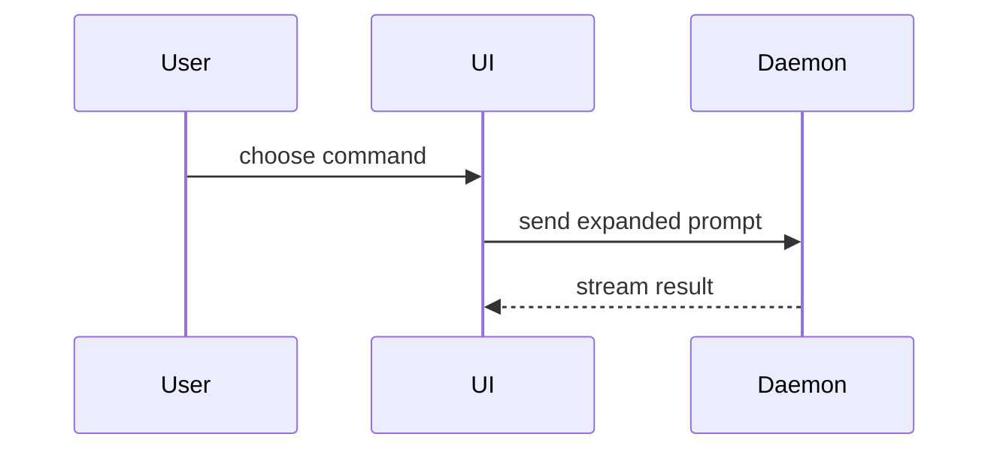

使用以下模板编写 PR 正文：

```markdown
## Summary

<图示、diff 草图或树状图>

## Evidence

- **Before:** <截图/输出/失败的测试运行>
  **After:** <截图/输出/通过的测试运行>

## Merge Danger

**Door:** <one-way 或 two-way>

<可选：说明>

**Blast Radius:** <用一个词描述>

<可选：合并可能带来的影响>
```

<a id="sections"></a>

## 章节

跳过所有开场白，文字保持简短。使用 `GLOSSARY.md` 中用户的领域语言。

<a id="summary"></a>

### 摘要

选择能讲清关键点的最小视图。

- 用伪代码展示逻辑或算法：

```text
on(save)
  if content is unchanged
    return cached result
  write new content
  return fresh result
```

- 用调用树展示运行时控制流：

```text
submitForm
  createSession
    persistPrompt
    launchAgent
  navigateToSession
```

- 用组件树展示 UI 结构，包括重要的状态和模块边界：

```text
<SessionPage> (apps/example/src/routes/session.tsx)
  useSessionEvents()
  <SessionToolbar>
    <RunSkillButton> (packages/ui)
```

- 用浅层文件树展示文件职责或大范围重构：

```text
src/
├── commands/       # parses user actions
├── sessions/       # owns session state
└── transport/      # sends API requests
```

- 用 Mermaid 展示组件交互、控制流或数据流：



- 当重点是发生了什么变化，而周围结构已经存在时，用 `diff`。让 diff 形态匹配主题。

组件变更：

```diff
 <SessionPage>
   useSessionEvents()
   <SessionToolbar>
+    <RunSkillButton />
   <SessionTimeline>
+    <SkillResultCard />
```

文件布局变更：

```diff
 src/
 ├── commands/
+│   └── show-me.ts       # expands the slash command
 ├── sessions/
-└── transport.ts
+└── transport/
+    ├── client.ts
+    └── stream.ts
```

调用树或调用栈变更：

```diff
 submitForm
   createSession
     persistPrompt
+    expandSkillMention
     launchAgent
-  navigateToSession
+  navigateToSession
+    subscribeToEvents
```

状态或控制流变更：

```diff
 on(save)
-  write content
+  if content is unchanged
+    return cached result
+  write new content
+  invalidate cache
```

- 大部分内容是新的、省略上下文会隐藏归属或顺序，或用户需要可复制的目标结构时，展示整个代码块：

```ts
function expandSkill(command: string): string {
  const skillName = command.slice(1);
  return `use the ${skillName} skill`;
}
```

<a id="guidance"></a>

#### 指引

把每张图放在它所支持的简短文字旁。只保留回答用户当前问题、或解决当前讨论点所需选项相关的调用、文件、props、状态和边界。

可以使用一种，也可以使用多种，通常不会全部使用。自行判断，不要淹没用户。

<a id="evidence"></a>

### 证据

用具体证据证明变更有效，展示前后对比。

环境已准备好且变更是视觉性的情况下，截图属于 S 级证据。

基于执行的证据属于 A 级：测试结果、控制台输出。用伪代码展示那个确切测试失败和通过的情况。

<a id="merge-danger"></a>

### 合并风险

描述这是单向门还是双向门。双向门可以走回来，单向门不行。回滚便宜的 PR 风险较低。涉及破坏性操作或难以逆转决策的变更，就是单向门。

影响范围指本 PR 所引入变更的潜在影响或波及范围。考虑所有可能性，例如布局偏移、使用方故障、移动端响应式表现等。
